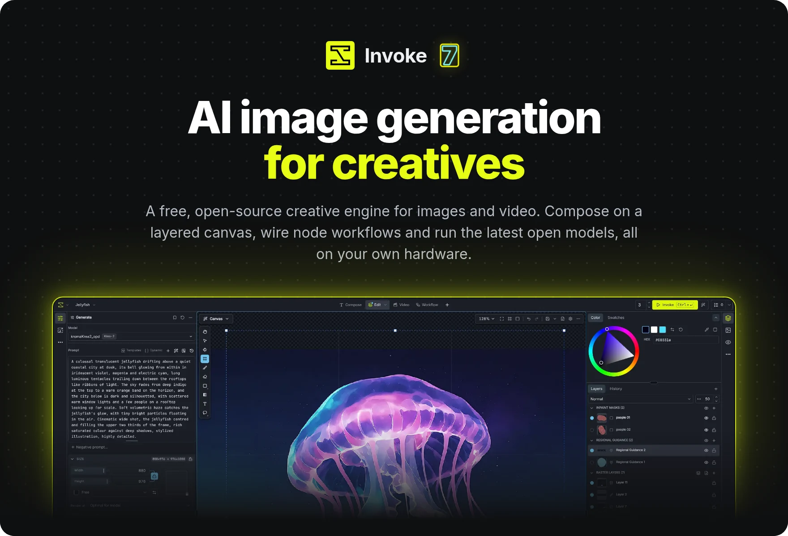
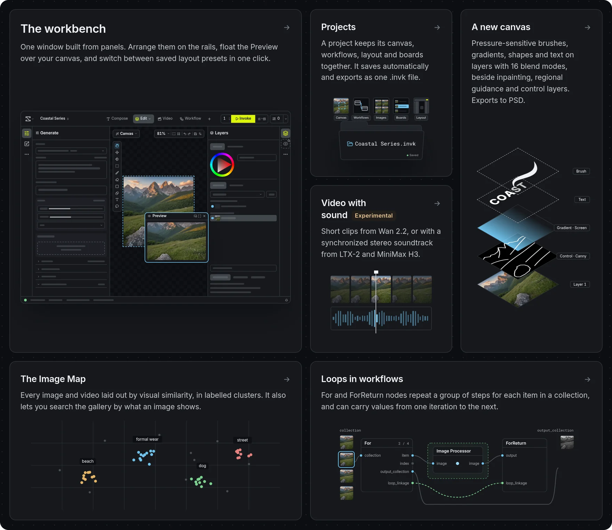
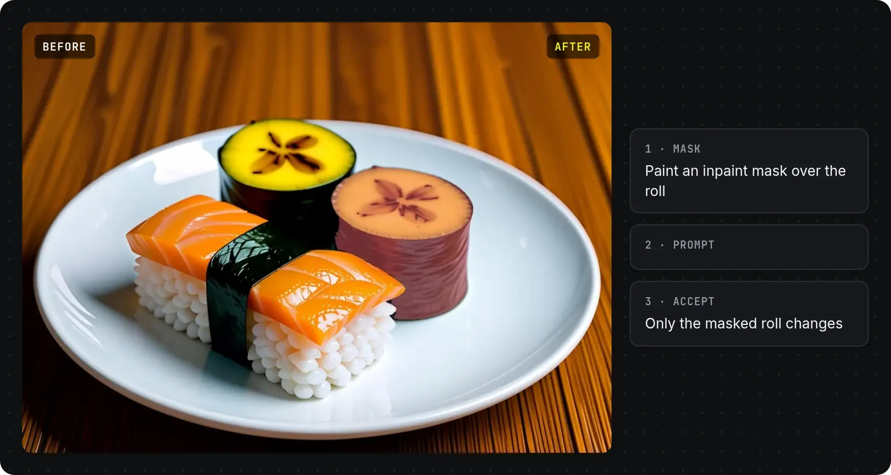
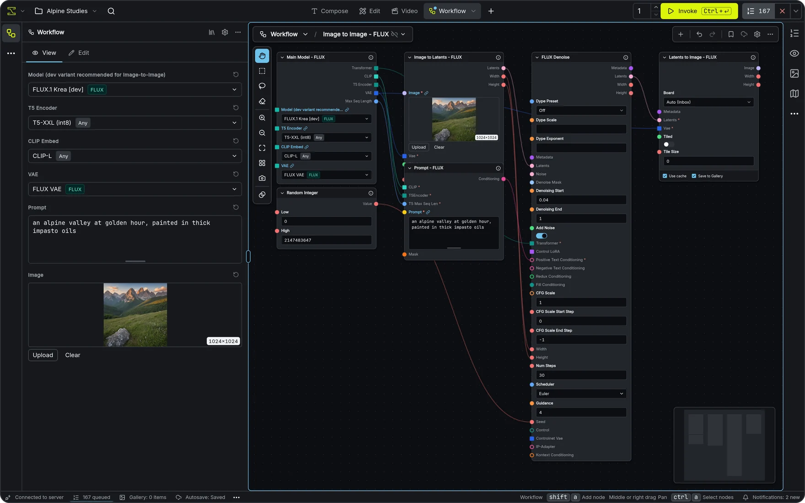
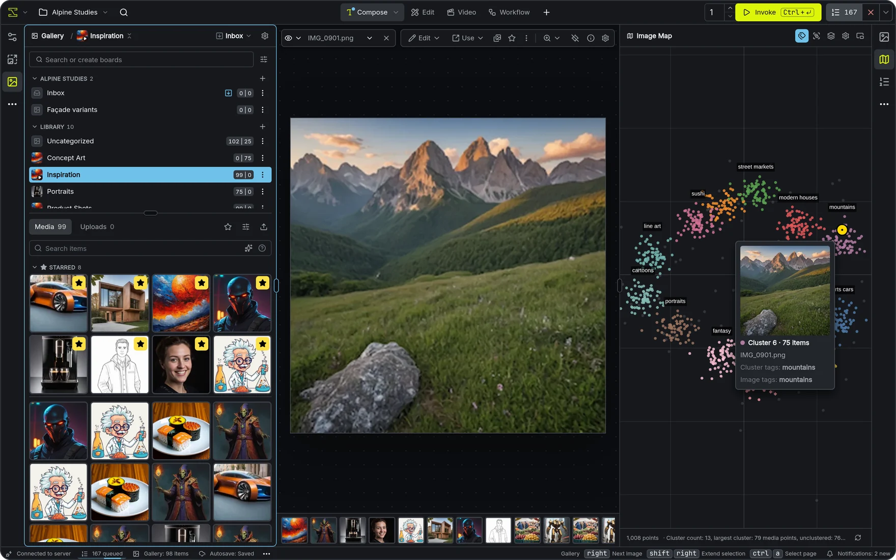
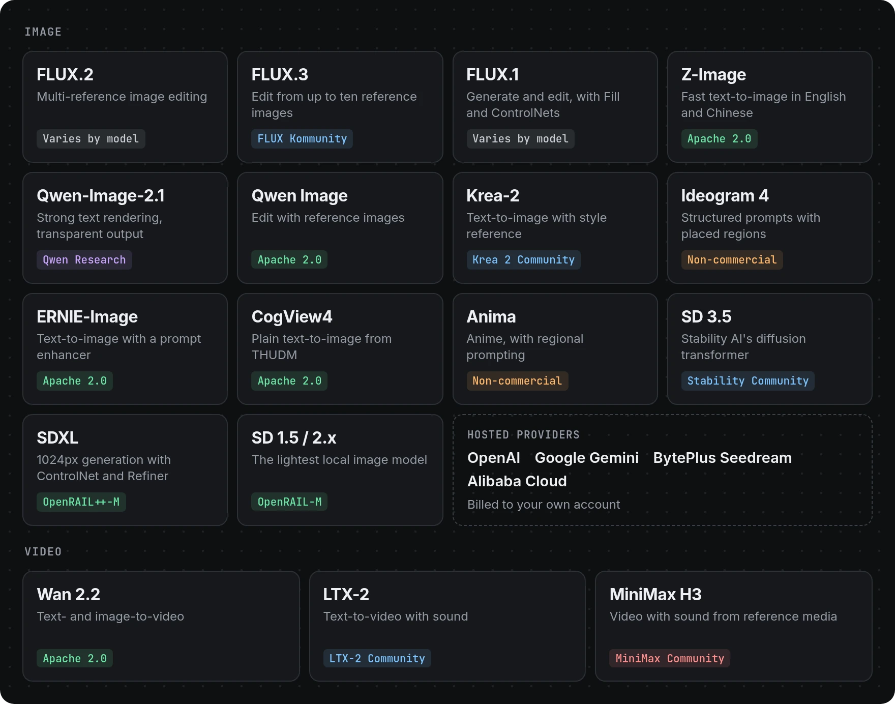
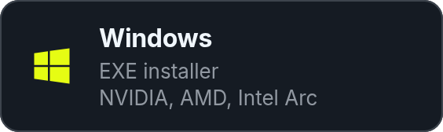
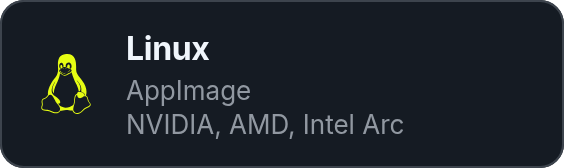
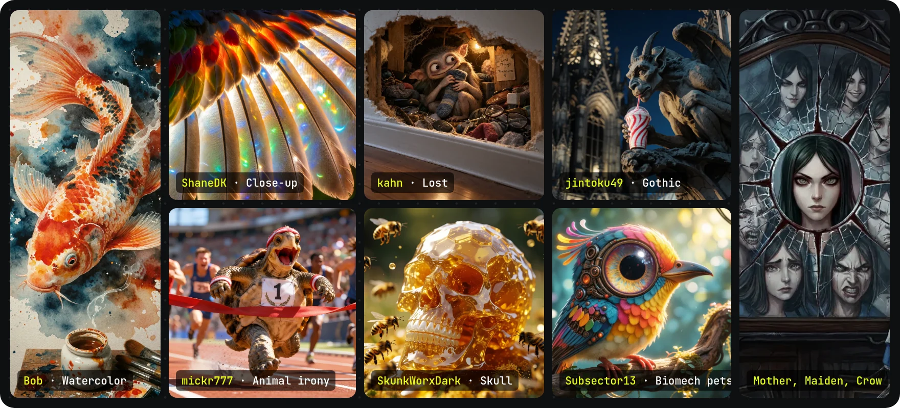

<!-- Images use absolute URLs because PyPI renders this file too. Sources: .github/readme/ -->

Invoke is a free, open-source creative engine that runs on your own hardware. Generate images and video, compose them on a layered canvas and build node workflows with the latest open models, all in one workbench.

&nbsp;
&nbsp;

Windows · macOS · Linux &nbsp;·&nbsp; NVIDIA · AMD · Intel Arc · Apple Silicon &nbsp;·&nbsp; Apache 2.0

[![latest release badge]][latest release link] [![discord badge]][discord link] [![github stars badge]][github stars link] [![translation status badge]][translation status link]

## What's new in Invoke 7

[Read the release notes →](https://v7.invoke.ai/releases/)

## Paint exactly where it matters

Mask an area, describe what belongs there and accept the result to a layer. Inpainting, outpainting, regional prompts and control layers all work on one canvas, beside pressure-sensitive brushes, 16 blend modes and PSD export.

[Canvas introduction →](https://v7.invoke.ai/users-guide/canvas/introduction/)

## Wire up your own pipeline

Chain steps into a node graph and run it from a simple form. Add community node packs with the Custom Node Manager, or follow the ComfyUI migration guide to the nodes you already know.

[Workflows guide →](https://v7.invoke.ai/users-guide/workflows/introduction/)

## Every image, easy to find

Boards and stars keep your images and videos in order, per project and across all of them. Search by prompt, or turn on image indexing and browse everything by what it shows on the Image Map.

[Gallery guide →](https://v7.invoke.ai/users-guide/gallery/introduction/) · [Image Map →](https://v7.invoke.ai/users-guide/image-map/introduction/)

## The latest open models, on your own hardware

Each model family has a guide to its variants, hardware needs and settings. Hosted providers add models such as GPT Image and Gemini, billed to your own account.

Model families as a list, with minimum VRAM

| Family | Type | License | Min. VRAM |
| --- | --- | --- | --- |
| [FLUX.2](https://v7.invoke.ai/users-guide/models/local-models/flux-2/) | Image | Varies by model | 8 GB |
| [FLUX.3](https://v7.invoke.ai/users-guide/models/local-models/flux-3/) | Image | FLUX Kommunity | 12 GB |
| [FLUX.1](https://v7.invoke.ai/users-guide/models/local-models/flux-1/) | Image | Varies by model | 10 GB |
| [Z-Image](https://v7.invoke.ai/users-guide/models/local-models/z-image/) | Image | Apache 2.0 | 8 GB |
| [Qwen-Image-2.1](https://v7.invoke.ai/users-guide/models/local-models/qwen-image-2-1/) | Image | Qwen Research | 16 GB |
| [Qwen Image](https://v7.invoke.ai/users-guide/models/local-models/qwen-image/) | Image | Apache 2.0 | |
| [Krea-2](https://v7.invoke.ai/users-guide/models/local-models/krea-2/) | Image | Krea 2 Community | 16 GB |
| [Ideogram 4](https://v7.invoke.ai/users-guide/models/local-models/ideogram4/) | Image | Non-commercial | 24 GB |
| [ERNIE-Image](https://v7.invoke.ai/users-guide/models/local-models/ernie-image/) | Image | Apache 2.0 | 24 GB |
| [CogView4](https://v7.invoke.ai/users-guide/models/local-models/cogview4/) | Image | Apache 2.0 | |
| [Anima](https://v7.invoke.ai/users-guide/models/local-models/anima/) | Image | Non-commercial | |
| [SD 3.5](https://v7.invoke.ai/users-guide/models/local-models/sd-3/) | Image | Stability Community | |
| [SDXL](https://v7.invoke.ai/users-guide/models/local-models/sdxl/) | Image | OpenRAIL++-M | 8 GB |
| [SD 1.5 / 2.x](https://v7.invoke.ai/users-guide/models/local-models/stable-diffusion-1-2/) | Image | OpenRAIL-M | 4 GB |
| [Wan 2.2](https://v7.invoke.ai/users-guide/video-generation/wan-22/) | Video | Apache 2.0 | 6 GB |
| [LTX-2](https://v7.invoke.ai/users-guide/video-generation/ltx-2/) | Video | LTX-2 Community | |
| [MiniMax H3](https://v7.invoke.ai/users-guide/video-generation/minimax-h3/) | Video | MiniMax Community | |

Hosted providers: [OpenAI](https://v7.invoke.ai/users-guide/models/external-models/openai/), [Google Gemini](https://v7.invoke.ai/users-guide/models/external-models/gemini/), [BytePlus Seedream](https://v7.invoke.ai/users-guide/models/external-models/seedream/) and [Alibaba Cloud](https://v7.invoke.ai/users-guide/models/external-models/alibabacloud/).

[Compare model families →](https://v7.invoke.ai/users-guide/models/model-families/)

## Install

The Invoke Launcher installs, updates and launches Invoke. Pick your platform:

Check the [system requirements][system requirements] first. Prefer to set things up yourself? Use the [manual install][manual install] or [Docker][docker docs]. Trouble installing? The [FAQ][faq] and [Discord][discord link] can help.

## Made with Invoke

Winners of the weekly Discord challenges. [Browse the showcase →](https://v7.invoke.ai/showcase/) · [See every challenge →](https://v7.invoke.ai/showcase/challenges/)

## Find your way in

| Create | Run | Build |
| --- | --- | --- |
| [Get started][installation docs] | [Configuration](https://v7.invoke.ai/configuration/invokeai-yaml/) | [Developer guide](https://v7.invoke.ai/development/) |
| [Canvas](https://v7.invoke.ai/users-guide/canvas/introduction/) | [Docker][docker docs] | [Contributing][contributing docs] |
| [Workflows](https://v7.invoke.ai/users-guide/workflows/introduction/) | [Multi-user mode](https://v7.invoke.ai/configuration/multi-user-mode/admin-guide/) | [Creating nodes](https://v7.invoke.ai/development/guides/creating-nodes/) |
| [Models](https://v7.invoke.ai/users-guide/models/introduction/) | [Low-VRAM mode](https://v7.invoke.ai/configuration/optimization/low-vram-mode/) | [Node packs](https://v7.invoke.ai/development/guides/creating-node-pack/) |

## Built in the open

Invoke is free software under the Apache 2.0 license, made by [contributors around the world][contributors]. The hosted Invoke.ai platform has shut down since its founding team joined Adobe. The open-source project carries on, stewarded by long-time core maintainers Lincoln Stein ([lstein](https://github.com/lstein)) and Vic ([Blessedcoolant](https://github.com/blessedcoolant)).

- **Contribute code, docs or tests.** Start with the [contributing guide][contributing docs] and say hi in [#dev-chat][#dev-chat].
- **Translate.** The app on [Weblate][translation status link], the docs on [Crowdin](https://crowdin.com/project/invoke).
- **Train your own LoRAs** with [Invoke Training](https://github.com/invoke-ai/invoke-training).
- **Report a bug** in [GitHub issues][github issues].

## Sponsors

Invoke's open-source development is funded by its sponsors. If Invoke is valuable to you or your business, [sponsor us][sponsor link]; it pays for maintenance, new features and community support.

<picture><source media="(prefers-color-scheme: dark)" srcset="https://raw.githubusercontent.com/invoke-ai/InvokeAI/main/.github/readme/blacksmith-dark.webp"></picture>

[Blacksmith](https://www.blacksmith.sh/) runs Invoke's continuous integration on its virtual machines.

**Power users ($50/mo)**

<a href="https://github.com/mickr777"> mickr777</a> &nbsp;
<a href="https://github.com/Astroburner"> Astroburner</a> &nbsp;
and 2 anonymous donors

**Backers ($15/mo)**

<a href="https://github.com/apokolypsse"> apokolypsse</a> &nbsp;
<a href="https://github.com/Romeotechguy"> Romeotechguy</a> &nbsp;
<a href="https://github.com/Pynshe9"> Pynshe9</a> &nbsp;
<a href="https://github.com/CarstenD74"> CarstenD74</a> &nbsp;
<a href="https://github.com/zamjoor"> zamjoor</a> &nbsp;
<a href="https://github.com/FusionBreak"> FusionBreak</a> &nbsp;
and 2 anonymous donors

## Thanks

Invoke is the combined effort of hundreds of people. Thank you for your time, work and care.

Copyright 2022-2026 InvokeAI Contributors. See [NOTICE](NOTICE).

[contributors]: https://v7.invoke.ai/contributing/contributors/
[contributing docs]: https://v7.invoke.ai/contributing/
[installation docs]: https://v7.invoke.ai/start-here/installation/
[system requirements]: https://v7.invoke.ai/start-here/system-requirements/
[manual install]: https://v7.invoke.ai/start-here/manual/
[docker docs]: https://v7.invoke.ai/configuration/docker/
[faq]: https://v7.invoke.ai/troubleshooting/faq/
[github issues]: https://github.com/invoke-ai/InvokeAI/issues
[sponsor link]: https://github.com/sponsors/invoke-ai
[#dev-chat]: https://discord.com/channels/1020123559063990373/1049495067846524939
[discord badge]: https://flat.badgen.net/discord/members/ZmtBAhwWhy?icon=discord
[discord link]: https://discord.gg/ZmtBAhwWhy
[github stars badge]: https://flat.badgen.net/github/stars/invoke-ai/InvokeAI?icon=github
[github stars link]: https://github.com/invoke-ai/InvokeAI/stargazers
[latest release badge]: https://flat.badgen.net/github/release/invoke-ai/InvokeAI/development?icon=github
[latest release link]: https://github.com/invoke-ai/InvokeAI/releases/latest
[translation status badge]: https://hosted.weblate.org/widgets/invokeai/-/svg-badge.svg
[translation status link]: https://hosted.weblate.org/engage/invokeai/
