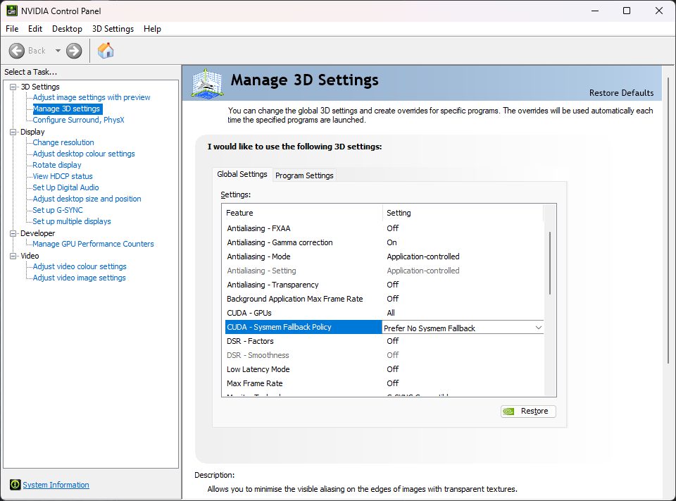

import SetupPicker from '@components/SetupPicker.astro';
import SetupSwitch from '@components/SetupSwitch.astro';
import SetupVariant from '@components/SetupVariant.astro';
import VramBudget from '@components/memory/VramBudget.astro';

Low-VRAM mode lets you generate with models larger than your GPU's memory, such as the ~24GB unquantized FLUX.1 dev.
Invoke keeps as many of a model's layers in VRAM as fit and streams the rest from RAM as each step needs them.

:::tip[On by default]
Low-VRAM mode (`enable_partial_loading: true`) is on in every install, so there is nothing to turn on. It works on
NVIDIA and AMD GPUs and on Intel GPUs, dedicated (Arc) or integrated. On Apple silicon and on the CPU, models load
whole into system memory and the VRAM settings on this page do not apply.

Not sure which memory option fits your GPU and model? Start with
[Which memory option do I need?](/configuration/optimization/memory-options/).
:::

## Platform notes

Some drivers move memory that does not fit in VRAM into much slower system memory instead of failing. Pick your setup
to see what to change for it.

<SetupPicker shows="notes" />

<SetupSwitch>
<SetupVariant os="windows" gpu="nvidia">
**Turn off the NVIDIA sysmem fallback.** When VRAM fills up, the Windows driver moves memory into system RAM. That
sounds like what Invoke does itself, but the driver's version is not made for workloads like Invoke's and slows
generation down massively.

1. Open the **NVIDIA Control Panel**.
2. In the left panel, expand **3D Settings** and click **Manage 3D Settings**.
3. In the right panel, set **CUDA - Sysmem Fallback Policy** to **Prefer No Sysmem Fallback**.


</SetupVariant>
<SetupVariant os="windows" gpu="amd">
**AMD on Windows (ROCm).** With a ROCm build of PyTorch (see the [System Requirements](/start-here/system-requirements/)),
Windows behaves as if NVIDIA's sysmem fallback were always on: an allocation that does not fit is moved into much
slower system memory instead of failing, and stays there. Task Manager shows it as shared GPU memory. Invoke works
around it:

- The model cache plans against the video-memory budget Windows grants Invoke, not the card's total VRAM.
- The PyTorch allocator defaults to `expandable_segments:True` (see `pytorch_cuda_alloc_conf` under
  [Settings](#settings)), so fragmented VRAM does not push allocations out.
- Decodes too large for the card are [tiled](#tiled-vae-decode-and-encode) before they start: waiting for an
  out-of-memory error does not work here, because none comes.
- When at least 512 MiB of Invoke's GPU memory stays in system memory after two generations in a row, the log says so
  (`Windows kept … GiB of Invoke's GPU memory … in shared system memory`). Other programs on the same GPU, such as games
  or browsers, can push Invoke's memory out too: close them. If it keeps happening, lower the image size, set
  `max_cache_vram_gb` lower or `device_working_mem_gb` higher, and restart Invoke to get the memory back into VRAM.
</SetupVariant>
<SetupVariant gpu="intel arm64">
Nothing to change for this GPU: the [settings](#settings) below apply as they are.
</SetupVariant>
<SetupVariant os="linux" gpu="nvidia amd">
Nothing to change for this GPU: the [settings](#settings) below apply as they are.
</SetupVariant>
<SetupVariant gpu="apple none">
Models load whole into system memory here, so partial loading and the VRAM settings below do not apply. To use less
memory, use a smaller build of the model: see the
[format comparison](/configuration/optimization/memory-options/#format-comparison).
</SetupVariant>
</SetupSwitch>

## Settings

All of these go in [`invokeai.yaml`](/configuration/invokeai-yaml/) and take effect after a restart. Most users need
none of them.

| Setting | Default | Change it when | Trade-off |
| --- | --- | --- | --- |
| `enable_partial_loading` | `true` | Every model you use fits in VRAM and you want them loaded whole. | Off, a model larger than free VRAM runs out of memory. |
| `device_working_mem_gb` | `3` | You get out-of-memory errors during generation. | More working memory leaves less VRAM for model layers, so more of them stream from RAM. |
| `reserve_vram_gb` | `0` | Another GPU program needs VRAM that Invoke should leave alone. | Models are offloaded or partially loaded sooner. |
| `max_cache_vram_gb` | unset: measured | You want Invoke to use less VRAM than it could. | Invoke stops measuring the GPU, so VRAM other programs use is not seen. |
| `max_cache_ram_gb` | unset: half your RAM minus 2 GB, within limits | You want more inactive models kept in RAM, or Invoke to use less RAM. | More: faster reloads, more RAM in use. |
| `keep_ram_copy_of_weights` | `true` | RAM is consistently tight. | Off: lower average RAM use, slower model switching and LoRA patching. |
| `offload_on_architecture_switch` | `true` | You alternate between model architectures that fit in VRAM together. | Off: other architectures' models stay in VRAM until a load needs the room. |
| `clear_vram_after_session` | `false` | A generation that runs fine once runs out of memory, or slows down sharply, when repeated. | A few seconds per queue item to reload models from RAM. |
| `pytorch_cuda_alloc_conf` | unset | You want to tune peak reserved VRAM, for example with `backend:cudaMallocAsync`. | The best value depends on the GPU, driver and CUDA version: test it. |
| `auto_tiled_decode` | `true` | You never want a decode tiled unless you ask for it. | Decodes too large for the card run out of memory. |
| `force_tiled_decode` | `false` | You want every supported decode and encode tiled. | Slower, and not pixel-identical to an untiled decode. |
| `wan_memory_optimization` | `false` | Wan videos run out of memory. | Much slower, and not bit-identical at the same seed. |
| `pid_memory_optimization` | `false` | PiD decodes run out of memory. | Not bit-identical at the same seed. |

The details of each:

<details>
<summary><span>`enable_partial_loading`: partial model loading</span></summary>

Invoke streams a model's layers between RAM and VRAM as they are needed. When a step needs layers that are not in
VRAM and there is no room for them, inactive layers are moved to RAM. To load every model whole instead, for example
on a GPU with plenty of VRAM where that is faster:

```yaml
enable_partial_loading: false
```

</details>

<details>
<summary><span>`device_working_mem_gb`: working memory</span></summary>

Invoke keeps some VRAM free as working memory for the computation itself: 3GB by default, enough for most uses. If
you still run out of memory, raise it:

```yaml
device_working_mem_gb: 4
```

Some operations know their needs in advance and ask for more. A VAE decode, which turns the generation's output into
an image, can need more than 3GB for a large image: Invoke calculates how much, and the model cache moves model layers
out of VRAM until that much is free. The larger reservation lasts only for that operation. `device_working_mem_gb` is
the floor: an operation never gets less.

</details>

<details>
<summary><span>`reserve_vram_gb`: VRAM kept outside the model cache</span></summary>

Keeps this much VRAM away from the model cache, for other GPU workloads the cache does not manage. It comes on top of
`device_working_mem_gb` and any operation's own request. To reserve 1GB:

```yaml
reserve_vram_gb: 1
```

</details>

<details>
<summary><span>`max_cache_vram_gb` and `max_cache_ram_gb`: cache sizes</span></summary>

Invoke caches models in RAM and VRAM so it rarely loads them from disk, and sizes both caches itself.

- **VRAM**: unless you set `max_cache_vram_gb`, Invoke measures the free VRAM before each load, taking into account
  what other programs use (with a ROCm build on Windows, the budget Windows grants Invoke).
- **RAM**: unless you set `max_cache_ram_gb`, the cache gets half your system RAM minus 2GB. On a machine with an
  NVIDIA, AMD or dedicated Intel GPU that is capped at the GPU's VRAM minus `device_working_mem_gb` (or at
  `max_cache_vram_gb` if you set it), elsewhere at 32GB, and it is never below 4GB. The log shows the result at
  startup: `Calculated model RAM cache size: … MB`.

For example, on a 32GB machine with no other heavy programs, `max_cache_ram_gb: 28` caches models aggressively, so
they reload faster.

`max_cache_vram_gb` caps everything the cache plans for on the GPU: model weights, working memory and the reserve. See
[The VRAM budget](#the-vram-budget) before setting it.

</details>

<details>
<summary><span>`keep_ram_copy_of_weights`: a RAM copy of loaded models</span></summary>

On by default: Invoke keeps a RAM copy of every model's weights while the model is in VRAM, which makes switching
models and patching LoRAs faster. Turning it off lowers the average RAM use (the peak likely stays the same), at the
cost of slower model switching and LoRA patching. On integrated Intel GPUs the setting is ignored, and the log says so
once.

```yaml
keep_ram_copy_of_weights: false
```

</details>

<details>
<summary><span>`offload_on_architecture_switch`: switching between model architectures</span></summary>

When a generation uses main models of another architecture than the previous one on the same GPU (say, FLUX.1 after
SDXL), Invoke first moves every model the new generation does not use from VRAM to RAM. Models both use, such as a
shared VAE or text encoder, stay. Moving models back costs a few seconds per switch, more with
`keep_ram_copy_of_weights: false`. If you alternate between architectures that fit in VRAM together, turn it off:

```yaml
offload_on_architecture_switch: false
```

</details>

<details>
<summary><span>`clear_vram_after_session`: clearing VRAM after every generation</span></summary>

After every queue item (every image of a batch), Invoke moves the models it holds in VRAM to RAM and hands the freed
memory back to the GPU driver. The models stay cached in RAM, so each queue item then costs a few seconds to reload
them, not a load from disk; with `keep_ram_copy_of_weights: false` also the time to copy them back to RAM. With several
GPUs, handing the memory back briefly holds up a generation running on another GPU. On the CPU, Apple silicon and
integrated Intel GPUs, whose VRAM is system memory, it changes nothing.

```yaml
clear_vram_after_session: true
```

</details>

<details>
<summary><span>`pytorch_cuda_alloc_conf`: the PyTorch allocator</span></summary>

Configures PyTorch's CUDA memory allocator, which can lower peak reserved VRAM. Using CUDA's own allocator works well
on many systems:

```yaml
pytorch_cuda_alloc_conf: "backend:cudaMallocAsync"
```

Unset, PyTorch's defaults apply, with one exception: with a ROCm build of PyTorch on Windows, Invoke uses
`expandable_segments:True`, because there fragmented VRAM makes Windows move allocations into system memory even when
enough VRAM is free. Setting `pytorch_cuda_alloc_conf`, or any of the `PYTORCH_ALLOC_CONF`, `PYTORCH_CUDA_ALLOC_CONF`
and `PYTORCH_HIP_ALLOC_CONF` environment variables, replaces that default. If `PYTORCH_CUDA_ALLOC_CONF` is already set
to another value, it wins over `pytorch_cuda_alloc_conf` and the log warns about it. The options are explained in
[PyTorch's documentation](https://pytorch.org/docs/stable/notes/cuda.html#optimizing-memory-usage-with-pytorch-cuda-alloc-conf).

</details>

<details>
<summary><span>`wan_memory_optimization`: Wan video memory</span></summary>

Lowers Wan's peak VRAM during denoising and decoding, at the cost of much slower generation and enough system RAM for
the offloaded weights:

- With partial loading on (the default) and an NVIDIA or AMD GPU, the Wan transformer keeps about 2GiB of its weights in
  VRAM and streams the rest from RAM. That trim may change nothing when the model cache already loaded no more than
  that. With `enable_partial_loading: false` the transformer stays fully in VRAM, but the other optimizations below
  still apply.
- Pointwise transformer activations run in chunks, and the TI2V model's per-token timestep conditioning is compacted.
- An untiled VAE decode streams its chunks straight to the MP4. A spatially tiled decode keeps its usual full-tile path.

Chunked matrix operations add up in a different order, so the image is not guaranteed to be bit-identical at the same
seed. `wan_memory_optimization: false` is the baseline path.

```yaml
wan_memory_optimization: true
```

Developers can check the Wan VAE memory estimate on their GPU: see
[Wan VAE Memory Calibration](/contributing/wan-vae-memory-calibration/).

</details>

<details>
<summary><span>`pid_memory_optimization`: PiD decode memory</span></summary>

[PiD](/users-guide/image-generation/advanced-topics/pid-decode/) decodes straight into high-resolution pixels, so its
activations and sampler can need more than a normal VAE decode's working memory. Partial loading shrinks PiD's weights
but not these full-resolution intermediates. This setting processes parts of PiD's pixel pathway in chunks and uses
float32 instead of float64 sampler intermediates, for every PiD decoder. Measured on an RTX 4090, peak activation memory
drops from ~3.7GB to ~1.5GB for a 2048px decode, and from ~0.9GB to ~0.5GB at 1024px. Speed stays about the same:
chunking costs about 4%, which the cheaper sampler math mostly offsets.

`device_working_mem_gb` is the floor of the reservation, so to get the full saving at 1024–2048px, lower it as far as
your GPU allows.

It is off by default because the output changes: the difference is small (around 43dB PSNR, indistinguishable side by
side), but the same seed and workflow will not reproduce an unoptimized decode. The setting is server-wide and not
recorded in image metadata, so each decode logs its resolution, patch-token count and whether chunking engaged
(`PiD memory optimization enabled for a … decode`).

```yaml
pid_memory_optimization: true
```

</details>

## Calibrating a model's working memory

In the Model Manager, select a model, open **Working memory** and choose **Calibrate**.

Invoke's decode estimates are measured on a few reference GPUs. Your GPU, driver and settings can need more or less. A
calibration measures what a model's VAE decode really takes on your GPU, and Invoke uses those measurements from then
on.

- **What it runs**: a few short text-to-image generations of the model at three sizes, up to the largest your GPU can
  decode in one piece with the VAE fully loaded in the memory free on it when the calibration is planned, in each VAE
  precision the model can decode in. Before each measured operation, Invoke moves the other models off the GPU, so the
  measured model is fully loaded. Each size runs once to warm up and twice more. The generations go through the normal
  queue, so they wait behind queued work and appear there like any other generation. Their images are intermediates:
  they never appear in the gallery or on a board, and Clear Intermediates removes them once the calibration has
  finished.
- **Who and where**: administrators only. It needs exactly one GPU set as the generation device; with several, it is not
  available. One calibration runs on the GPU at a time: starting another while one runs, from another browser tab for
  instance, is refused until it has finished or you stop it. That includes the moment between two of its sizes: another
  administrator's calibration whose page was closed holds the GPU for two more minutes. Your own interrupted calibration
  does not hold you back: starting a new one replaces it. If another calibration ran on the GPU in between all the same,
  the first one cannot go on: calibrate it again. If the model, or another model the calibration loads, is replaced or
  reinstalled while the calibration runs, the sizes still to come fail with a note to calibrate again, and the
  calibration counts as stopped: the sizes it already measured are discarded too, since they measured the model as it
  was before.
- **What it changes**: decodes up to the largest size measured use the measured values, plus the same 5% margin the
  built-in values carry. Measurements that a fragmented GPU memory pool inflated, or taken while the VAE was only partly
  on the GPU, are left out, and the Model Manager shows those sizes as not counted. Larger decodes use whichever of the
  measured and the built-in estimate is larger. Other models that decode the same way (for example, SD1.5 and SDXL
  models when you calibrate an SDXL model) use the measurements too. Because the estimate decides when a large decode is
  split into tiles up front, a calibration can change which large images are decoded in tiles.
- **Where it applies**: on this kind of GPU only (identical cards share it), and only while the software that affects
  memory stays the same: the operating system, the PyTorch and GPU runtime versions, the memory-related environment
  variables and Invoke's memory settings. After such a change Invoke goes back to the built-in values until you
  calibrate again. A driver update keeps the measurements but marks them as possibly out of date until you calibrate
  again.
- **Stopping it**: stopping a calibration started from the Model Manager, or clearing the queue while it runs, discards
  everything that calibration measured, the sizes that already finished included; the Model Manager shows those sizes as
  not counted because the calibration was stopped. Calibrate again to measure them. If a size fails for another reason,
  for example because the GPU runs out of memory at the largest size, the sizes that finished still count. A calibration
  run sent through the API without an `attempt_id` counts on its own instead: stopped, it keeps the sizes it measured.
  If they should not count, remove the run through the API (`DELETE /api/v2/models/working_memory/runs/{run_id}`), or
  reset the model's calibration in the Model Manager.
- **What it does not cover**: image-to-image and inpainting encodes keep the built-in values.
- **Reset**: remove a model's calibration from the Model Manager, or every calibration of this GPU; the change applies
  right away. Resetting one model removes only its own measurements: where other models' measurements cover the same
  decode, those still apply, and the Model Manager shows which models measured it. Otherwise the built-in values apply
  again.

The measurements are stored next to the database in `working_memory/<device class id>.json`.

## The VRAM budget

Most users should leave `max_cache_vram_gb` unset. If you set it, it caps everything the model cache plans for on the
GPU, and the cache subtracts the working memory and the reserve from it before loading any model:

<VramBudget title="What the model cache may fill with a 12GB cap and default settings" cap={12} working={3} reserve={0} />

- Set it no higher than the VRAM Invoke can actually use. A cap replaces the measurement of free VRAM, so memory other
  programs take is no longer accounted for.
- A cap at or below `device_working_mem_gb` plus `reserve_vram_gb` leaves no room for models, which forces aggressive
  offloading. With `device_working_mem_gb: 4` and `reserve_vram_gb: 1`, a 12GB cap leaves 7GB for models.
- Most people who set it want Invoke to use much less VRAM, and set it well below their GPU's VRAM.

## Tiled VAE decode and encode

Without tiling, the memory a VAE needs grows with the square of the image size: for FLUX.1, an untiled 3072² encode
peaks at about 18.8GiB on an RTX 4090, a tiled one at 0.8GiB, and tiled memory stays roughly flat as the image grows.
Tiling costs some speed on smaller images, and a tiled result is not pixel-identical to an untiled one.

| Model | Automatic (`auto_tiled_decode`) | Always (`force_tiled_decode`) | Per node (**Tiled** field) | Retried tiled after out of memory |
| --- | --- | --- | --- | --- |
| SD 1.5, SDXL | – | decode, encode | **Latents to Image**, **Image to Latents** | – |
| FLUX.1 | decode | decode, encode | **Latents to Image**, **Image to Latents** | decode, encode |
| FLUX.2 | decode | decode, encode, [dev] ControlNet control and inpaint images | **Latents to Image**, **Image to Latents**, **FLUX.2 [dev] ControlNet** | decode, encode |
| Z-Image | decode | decode, encode, ControlNet control image | **Latents to Image**, **Image to Latents**, **Z-Image ControlNet** | decode |
| Qwen-Image | decode | decode, encode, ControlNet control and inpaint images | **Latents to Image**, **Image to Latents**, **Qwen Image ControlNet** | – |
| Qwen-Image-2.1 | decode, encode | decode, encode | **Latents to Image**, **Image to Latents** | – |
| Krea-2 | decode | decode, style reference | Qwen-Image's **Latents to Image** | – |
| Anima | decode, whatever the setting | encode | **Image to Latents - Anima** | decode |
| Wan 2.2 | video decode (**Latents to Video - Wan 2.2**) | – | – | – |
| SD 3, LTX-2 | – | – | – | – |

- **Automatic** tiling starts only when an untiled decode would take most of the memory the GPU keeps resident, so it
  kicks in only for images too large for the card: for Z-Image on a 16GB GPU, from about 1850x1850 on NVIDIA and from
  about 1500x1500 on AMD, whose convolution library needs more memory. Anima tiles a little earlier, because its untiled
  decode pushes the Anima model out of VRAM on 8GB cards. Wan videos tile from 832x480 on 8GB cards and from 720p on
  16GB cards.
- **Krea-2** decodes with the Qwen-Image **Latents to Image** node, so it follows that node's settings and field.
- **MOSS-Image** encodes and decodes with the FLUX.2 **Latents to Image** and **Image to Latents** nodes, so it
  follows the FLUX.2 row for decodes and encodes.
- **LTX-2** always decodes its video in tiles, sized by the node's own **Tile Size** fields.
- The [Upscale panel](/users-guide/image-generation/upscale/) turns tiling on by itself. Nodes with a **Tiled** field
  also have a **Tile Size** field.

<details>
<summary>Turning automatic tiling off</summary>

```yaml
auto_tiled_decode: false
```

Decodes then run untiled unless tiling is requested. A decode too large for the card runs out of memory: the FLUX.1,
FLUX.2 and Z-Image decodes retry tiled (the log says `VAE decode ran out of memory; retrying with tiling`), the others
fail, and on Windows the driver may move the decode into system memory and run it very slowly instead. On a ROCm build
under Windows, automatic tiling compares against the video-memory budget Windows grants Invoke, which is lower than the
card's total and lower again while another program uses the GPU.

Anima ignores this setting: there, tiling a large decode is what keeps the Anima model in VRAM, so untiled decodes would
only be slower.

</details>

<details>
<summary>How different is a tiled image?</summary>

The VAE looks at the whole image at once, so the difference is spread over the image rather than limited to the tile
seams. It is small: for a 1024x1024 FLUX.2 Klein image, 5.6 of 255 per pixel value on average, with no visible seams.
But the same seed will not reproduce an untiled result exactly.

</details>

## Troubleshooting

| Symptom | What to do |
| --- | --- |
| Out-of-memory errors during generation | Raise `device_working_mem_gb` to 4 or more. Check that `max_cache_vram_gb` is not set too high (see [The VRAM budget](#the-vram-budget)). |
| Out of memory while decoding a large image | Check the [tiling table](#tiled-vae-decode-and-encode): set `force_tiled_decode: true`, or turn on **Tiled** in the node. SD 1.5 and SDXL are not tiled automatically. |
| A generation runs fine once, then runs out of memory or slows down sharply when repeated | `clear_vram_after_session: true`. |
| Generation is very slow and Task Manager shows shared GPU memory in use (Windows) | NVIDIA: turn off the sysmem fallback. AMD: close other programs using the GPU and see the AMD notes. Both under [Platform notes](#platform-notes). |
| Switching between, say, SDXL and FLUX.1 takes a few seconds every time | If both fit in VRAM together, `offload_on_architecture_switch: false`. |
| RAM use is consistently high | `keep_ram_copy_of_weights: false`, or a lower `max_cache_ram_gb`. |
| Invoke exits with error code `3221225477` on Windows, or crashes with `0xc0000005` in `eventvwr.msc` | The Windows page file ran out: see below. |

### Windows page file

Invoke needs a lot of virtual memory (also called committed memory). On Windows this can hit the page file's size
limit, and Invoke crashes; [issue #7563](https://github.com/invoke-ai/InvokeAI/issues/7563) has the technical details.
The crash usually comes with Windows error code `3221225477`, or with no error at all and an error `0xc0000005` (the same
code in hex) in `eventvwr.msc`.

- Make sure the disk has room for the page file to grow. Watch disk usage while Invoke runs: if it climbs to near 100%
  before the crash, this is very likely the cause. Free up disk space.
- Make sure the page file is set to **System managed size** (the default), not a custom size, so it grows as needed.
