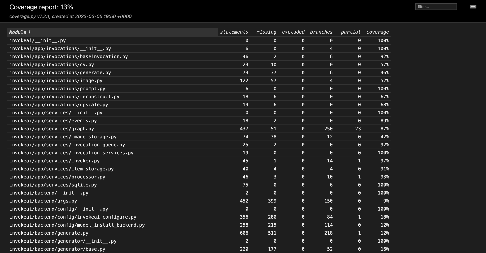

import { Tabs, TabItem } from '@astrojs/starlight/components';

## Frontend Tests

The default frontend is `webv2`, with unit and Chromium suites. Run commands from the repository root:

<Tabs>
  <TabItem label="Make">
    ```bash
    # Run the default frontend unit suite once.
    make frontend-test
    ```
  </TabItem>
  <TabItem label="pnpm">
    ```bash
    cd invokeai/frontend/webv2
    pnpm test
    pnpm test:browser
    # Complete milestone gates, including performance, project files, and accessibility.
    pnpm check:release
    ```
  </TabItem>
</Tabs>

Install Chromium with `pnpm exec playwright install chromium` from `invokeai/frontend/webv2` if needed. Read `webv2/AGENTS.md` for test ownership and browser verification rules.

The legacy frontend remains in `invokeai/frontend/webv1`. From that directory, run its separate suite with `pnpm test:no-watch` and its checks with `pnpm lint`.

## Backend Tests

We use `pytest` to run the backend python tests. (See [pyproject.toml](https://github.com/invoke-ai/InvokeAI/blob/main/pyproject.toml) for the default `pytest` options.)

### Fast vs. Slow
All tests are categorized as either 'fast' (no test annotation) or 'slow' (annotated with the `@pytest.mark.slow` decorator).

'Fast' tests are run to validate every PR, and are fast enough that they can be run routinely during development.

'Slow' tests are currently only run manually on an ad-hoc basis. In the future, they may be automated to run nightly. Most developers are only expected to run the 'slow' tests that directly relate to the feature(s) that they are working on.

As a rule of thumb, tests should be marked as 'slow' if there is a chance that they take >1s (e.g. on a CPU-only machine with slow internet connection). Common examples of slow tests are tests that depend on downloading a model, or running model inference.

### Running Tests

Below are some common test commands:

```bash
# Run the fast tests from the repository root using the Makefile shortcut.
make test

# Run the fast tests. (This implicitly uses the configured default option: `-m "not slow"`.)
pytest tests/

# Equivalent command to run the fast tests.
pytest tests/ -m "not slow"

# Run the slow tests.
pytest tests/ -m "slow"

# Run the slow tests from a specific file.
pytest tests/path/to/slow_test.py -m "slow"

# Run all tests (fast and slow).
pytest tests -m ""
```

### Test Organization

Most backend tests live in the [`tests/`](https://github.com/invoke-ai/InvokeAI/tree/main/tests) directory. When adding a new backend test, prefer keeping it near the corresponding module area so related code and tests stay easy to find together.

### Tests that depend on models

Tests do not download models routinely, and there is no shared helper that installs one. Prefer small CPU fixtures built in the test. A test that needs a real model must be marked `slow` (excluded by default and in CI) and must not download large models unless it is run on purpose. Keep the total number of models the slow tests need low, re-use models other tests already need, and comment why a new one is required.

### Windows ARM64 in CI

The Windows ARM64 job exercises the lockfile's ARM64 dependency fork and is slow, so it runs in shards, each a disjoint set of test files (`tests/sharding.py`, balanced by the durations in `tests/shard_durations.json`). It runs, with every shard, for every change the Python test filter matches (the filter the other Python jobs use), on pull requests, in the merge queue and on pushes to `main`; `always_run` runs it unconditionally. A maintainer is meant to mark `py3.12: windows-arm64` (not the individual shards) as a required check; once it is, the merge queue blocks on ARM64 for every change that runs the Python tests.

Every shard uploads the durations it measured, but only from a session that exited cleanly. To refresh the balance, download the `shard-durations-*` artifacts of a run on `main` or in the merge queue where every shard passed (artifacts of a fork's pull request are written by that pull request's code), and merge them into `tests/shard_durations.json` from the repository root. The merge updates the existing entries and drops files that no longer exist:

```bash
gh run download <run-id> --pattern 'shard-durations-*' --dir <dir>
uv run --no-sync python -m tests.sharding <dir>/*/*.json
```

`--shard=K/4` reproduces CI's shard only on Windows ARM64 with the same lockfile: some files skip themselves at import there (for example `test_umap_import.py`), and the partition depends on the set of collected files. Anything that narrows the collection (`-k`, `--lf`, paths) changes it as well. To reproduce a failure, run the failing test files named in the job log directly, without `--shard`.

### Test Coverage

To review test coverage, append `--cov` and the report formats you want to your pytest command:

```bash
pytest tests/ --cov --cov-report=term --cov-report=html --cov-report=xml
```

Test outcomes and coverage will be reported in the terminal. In addition, a more detailed report is created in both XML and HTML format in the `./coverage` folder. The HTML output is particularly helpful in identifying untested statements where coverage should be improved. The HTML report can be viewed by opening `./coverage/html/index.html`.

:::note HTML coverage report output example
  

  
:::
